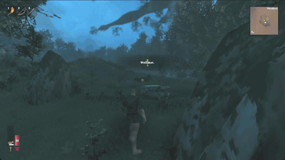
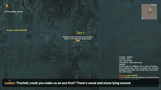
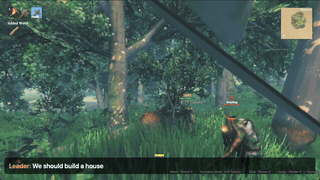
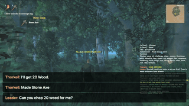
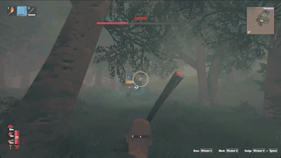
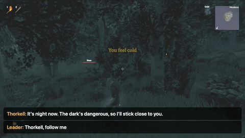
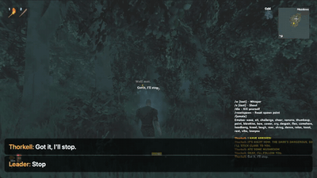
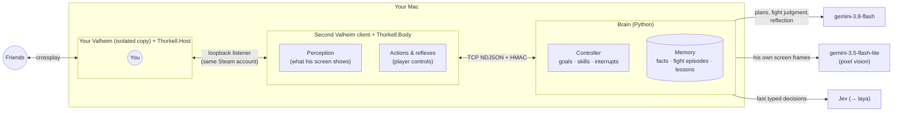

# Thorkell

**A Valheim companion that joins your world as a real second player — and sees, decides, acts and talks
like someone playing for the first time.**

<p align="center">
  
  <br><sub>Real game, Thorkell's own screen. Captions are the chat lines: the leader's and Thorkell's own. Nothing is scripted on his side.</sub>
</p>

You talk to Thorkell in game chat, the way you would talk to a friend. He has no script: he reads his own
game screen, remembers what he has seen and learned, works out what you mean, and does it with the same
controls a player has. Ask for an axe in a new world and he picks up branches and stones until the recipe
shows up. Say "we should build a house" and he asks how big. Lose to the first boss and he thinks the fight
over and comes back with a different plan.

> Thorkell is a research project and a work in progress. It runs on macOS with a specific Valheim build;
> see [Status](#status) for what has been verified in the real game.

## What he does

| | |
|:---:|:---:|
| <br>**"Could you make us an axe first?"** — empty-handed in a new world, he picks up branches and stones until the recipe shows up | <br>**"We should build a house"** — he proposes a size from what he has and asks before starting |
| <br>**"Can you chop 20 wood for me?"** — the stone axe breaks halfway; he notices, makes another and finishes | <br>**Eikthyr, together** — his bow breaks mid-fight, he switches to the club, and afterwards says what he will do differently |
| <br>**"Thorkell, follow me"** · **"Stop"** | <br>**"Follow me"** from 270 m away — he finds you on the map |

| You say | Thorkell |
|---|---|
| "Thorkell, follow me" · "Stop" · "Follow me" from 300 m away | Answers in chat, follows, stops; finds you on the map when you are out of sight |
| "Could you make us an axe first?" | Starts empty-handed, picks up branches and stones, sees the axe in his crafting menu, makes it |
| "Can you chop 20 wood for me?" | Fells trees; when the stone axe breaks he notices, makes another and finishes the job |
| "We should build a house" | Does not just start: proposes a size from what he has and asks |
| "Keep it small, just enough to keep the rain off" | Finds flat ground, builds a workbench, walls and a roof |
| "I'm hungry, find us something to eat" | Picks what he can see (berries, mushrooms) or hunts, and hands some over |
| "Go hunt a deer, we need its trophy" | Learns that deer bolt when chased and creeps up crouching |
| "Let's take him down together!" (at Eikthyr's altar) | Reads the boss from its health bar and looks, keeps his distance with the bow, backs off toward you when hurt, and afterwards says what he learned |

He also defends himself when something attacks him mid-task, eats when his food runs low, stops working
at night and stays near you, remembers what you taught him ("greydwarves are weak to blunt") and checks it
in his next fight.

## How it works



| Layer | Runs | Does |
|---|---|---|
| **Body** — BepInEx plugin in a second game client | every frame | Perception filtered to what a person would see from Thorkell's screen; actions through the player's own controls (move, aim, swing, craft, build, eat); reflexes (defend, flee when nearly dead, get unstuck) |
| **Fast decisions** — Jev, later a fine-tuned local laya | ~0.2 s | Typed choices under a deadline, e.g. how to answer a hit |
| **Slow brain** — `gemini-3.8-flash` | seconds, on events | Reads an open request against what he sees, knows and remembers; plans, asks back, or just answers; decides how to fight something big; reflects after a fight |
| **Eyes** — `gemini-3.5-flash-lite` | ~1–3 s, on demand | Reads his own rendered frames: portals, doors, the leader's summon, what something looks like |
| **Memory** — SQLite | — | What the game showed him, what he was told (as hypotheses), what he verified; fight records and lessons with the numbers they came from |

Three rules shape everything:

1. **Information parity.** The brain only gets what a person controlling Thorkell's character could know
   from his screen: names on tags he has looked at, his bars and bag, menus the game unlocked for him, a
   boss's health bar, chat. No prefab names, AI internals or tool tiers. He does not "know" Valheim.
2. **Judgment by models, the body in code.** Code decides *when* to think (something big noticed him, a
   step failed, a fight ended) and carries out actions with checks against the world (a tree's HP went down,
   the item arrived in the bag). *What* to do, how to fight and what to take from a loss are model
   judgments. Safety rules are not hard-coded; he is shown the situation and judges it.
3. **Learning lives in his memory, not in constants.** A lost fight becomes a lesson with numbers ("inside
   16 m I was hit by lightning"), which the next fight cites and then confirms or refutes.

Why these choices, what was tried and dropped, and what each model measured: **[docs/JOURNEY.md](docs/JOURNEY.md)**.

## Status

Verified in the real game (macOS, Valheim 1.0.20) unless noted:

- Joining as a second player into a crossplay host, chat both ways, following across the map.
- Making an axe from nothing, chopping, asking how big a house should be, building a small shelter.
- The first boss, Eikthyr, defeated together with a leader holding it in front: in Korean play and in 2
  of 5 English fights (October 2026, the clip above is one). The others ended with Thorkell dead or the fight
  stalled; he reflects after each and the next attempt cites what he learned. Fighting it alone is not
  reliable yet.
- Playing in English (both games, chat and Thorkell's thinking) — added for this README.
- Voice conversation (`gemini-3.8-live`) and the local laya model are built and tested offline but not
  used in play yet.

[docs/JOURNEY.md §9](docs/JOURNEY.md) lists every behavior with where it was verified (real game, real
model, or simulator), and §10 the known limitations.

## Running it

Requirements: an Apple Silicon Mac with Rosetta, Steam with Valheim **1.0.20** (other builds are refused
by the version gate), .NET 9 SDK, [uv](https://docs.astral.sh/uv/), and a Gemini API key in `.env` at the
repo root (`GEMINI_API_KEY=…`; `TYPESAFE_API_KEY` for Jev).

```bash
cd brain
uv run thorkell doctor            # checks the machine
uv run thorkell vendor            # downloads the pinned BepInExPack
cd .. && dotnet build Thorkell.sln -c Release && cd brain

# Play together in a brand-new world, in English. Create the world in the game menu when your window opens.
uv run --env-file ../.env thorkell play --rehearsal thorkell-en --new --config thorkell.play.en.toml
```

Your real installation, saves, Steam Cloud and settings are never written: both games run from APFS clones
under `~/Library/Application Support/Thorkell/` inside a `sandbox-exec` profile, and every run checks
afterwards that nothing of yours changed. A small macOS app (`tools/gui`, `build.sh`) wraps the same
command.

No game? `uv run thorkell sim` runs the brain against a 2D simulator that speaks the same protocol as the
game plugin.

## Tests

```bash
dotnet test Thorkell.sln                                     # protocol and core logic (C#)
cd brain && uv run pytest && uv run ruff check && uv run mypy  # brain, including simulator scenarios
uv run --env-file ../.env thorkell scenario talk --config thorkell.play.en.toml   # real game, one at a time
uv run --env-file ../.env thorkell judge --language en        # the real model's judgment on fixed situations
```

The real-game scenarios (`talk`, `fresh`, `boss`, `sight`, `travel`, …) launch both games, play a harness
leader that only talks in chat (and, for tests, may move), and check outcomes in the world. With
`--record` they also record Thorkell's window; `thorkell video <run>` cuts it into the clips above. The
scenes are described in [docs/video/readme-scenarios.md](docs/video/readme-scenarios.md).

## Layout

| Path | What |
|---|---|
| `plugin/Thorkell.Body` | Bot client plugin: isolation, perception, events, actions, reflexes |
| `plugin/Thorkell.Host` | Host plugin: loopback listener for the bot, crossplay shim, chat names |
| `plugin/Thorkell.Wire`, `Thorkell.Core`, `Thorkell.Compat` | Protocol, pure logic, game API handles and version gate |
| `brain/thorkell` | Controller, skills, planner, fight judgment, eyes, memory, voice, simulator, CLI |
| `protocol/v1` | Message fixtures shared by the C# and Python tests |
| `tools/gui`, `tools/record` | The macOS app; window recording helpers |
| `docs/` | [JOURNEY.md](docs/JOURNEY.md), research, design notes, game API notes, [Korean README](docs/README.ko.md) |

## License

MIT — see [LICENSE](LICENSE). Thorkell is a fan project, not affiliated with or endorsed by Iron Gate or
Coffee Stain. Valheim is not included; you need your own copy. Game code is never redistributed: the
plugins reference the installed game's assemblies at build time.
